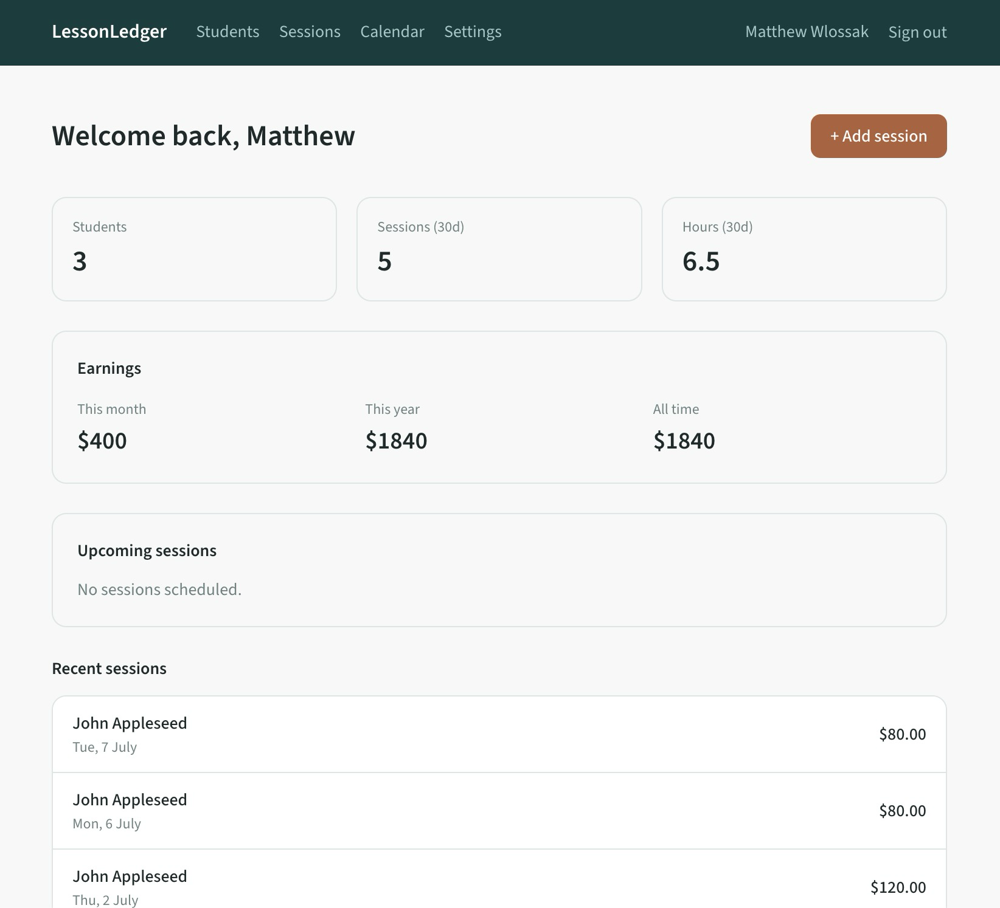

# LessonLedger

A web app for tutors to log sessions, track income per student, and export monthly invoices.

**Live:** https://lesson-ledger-seven.vercel.app/



## Why I built it

I tutor, and my sessions were tracked in Airtable, which is a form and survey tool. It was never built for this, so putting together the monthly invoice was slow and tedious. I had to remember the date and duration of every session, and Airtable does not surface those details in a usable way. I wanted software shaped around the real workflow of logging sessions, tracking income, and knowing which invoices have been paid.

I built LessonLedger for that, and I use it myself. It saves me real time each month and takes the mental load out of invoicing. I also built it so other tutors can sign up and use it, each with their own private data.

## Features

- Fast session logging: date, time, duration, one or more students, and a note on what was covered
- Automatic rate calculation by tier and group size, with a manual override when needed
- Per-student history and total earnings over selectable time periods
- Calendar view of upcoming and past sessions
- One-click monthly invoice export to Excel, matching a real invoice format
- Multi-user accounts, so each tutor has their own private students and sessions

## Tech stack

- **Framework:** Next.js (App Router) + React, TypeScript
- **Database:** Neon (serverless Postgres) with Prisma ORM
- **Auth:** NextAuth (Auth.js), bcrypt-hashed passwords, middleware route protection
- **Invoicing:** ExcelJS
- **Styling:** Tailwind CSS
- **Hosting:** Vercel

## Implementation details I cared about

- All date logic is pinned to Melbourne time, so upcoming and past sessions behave the same whether the server runs locally or on Vercel in UTC.
- Earnings are always computed on demand from duration and rate. The database never stores money.
- Every server action verifies that the students and sessions being changed belong to the signed-in user.

For a full tour of how it works, see [`docs/ARCHITECTURE.md`](docs/ARCHITECTURE.md).

## Running locally

```bash
# 1. Install dependencies
npm install

# 2. Set up environment variables (see below)
cp .env.example .env   # then fill in the values

# 3. Apply the database schema
npx prisma migrate dev

# 4. Start the dev server
npm run dev
```

Then open http://localhost:3000.

### Environment variables

Copy `.env.example` to `.env` and fill in:

| Variable | What it is |
| --- | --- |
| `DATABASE_URL` | Neon Postgres connection string |
| `AUTH_SECRET` | Secret used by NextAuth to sign sessions |

Real values live only in `.env`, which is gitignored and never committed.

## What I'd build next

- Invoice payment tracking, so I can see at a glance which invoices are still outstanding. This was one of the original reasons for the project and is the next thing on my list.
- Recurring sessions, so a weekly booking can be set up in one step.
- In-app rate configuration, since rates currently live in code.
- Automated tests around the invoice and timezone logic.
